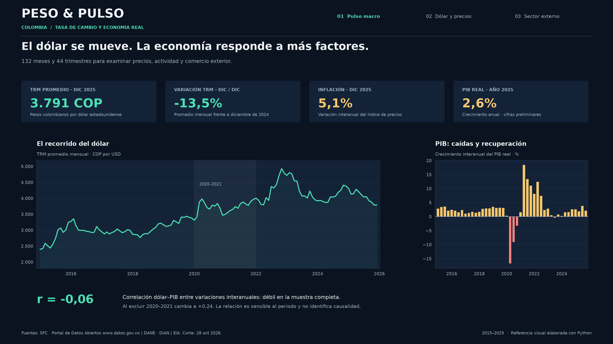
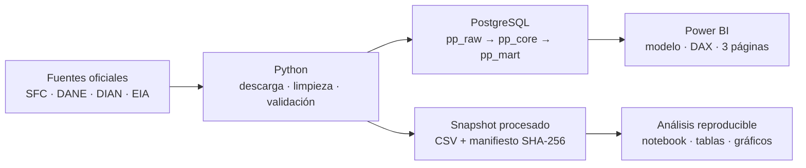
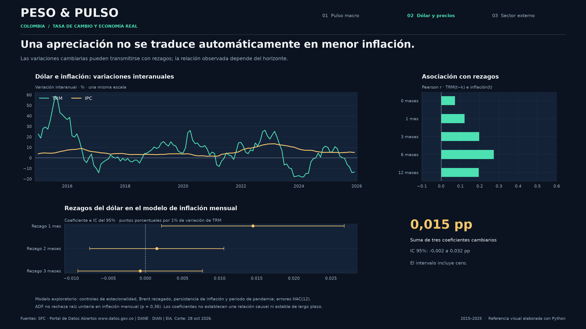
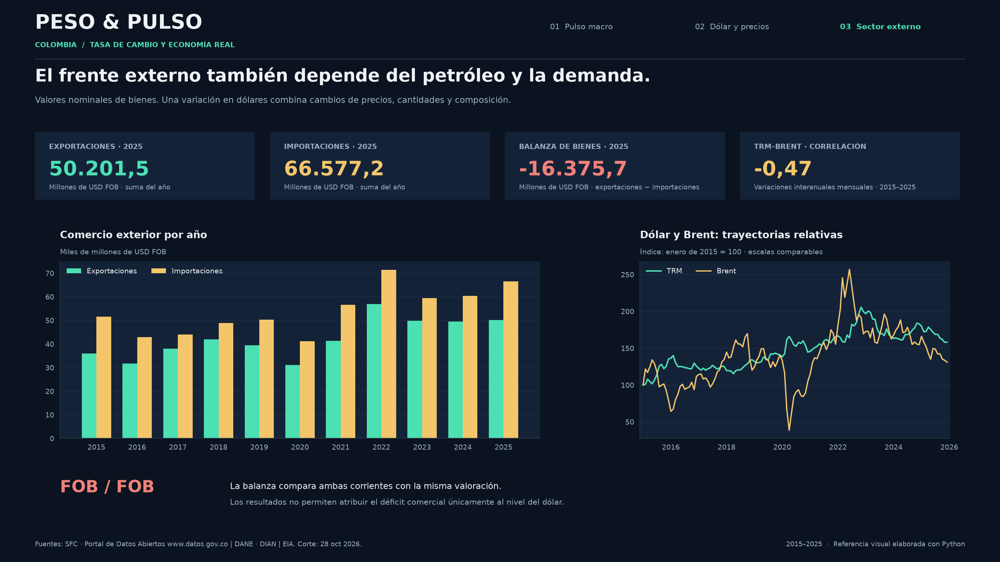

# Peso & Pulso

**El dólar frente a los precios, el comercio exterior y la actividad económica de Colombia.**




¿Un dólar más barato coincide con una economía más dinámica? Este proyecto cruza **132 meses y 44 trimestres de datos oficiales** para examinar esa pregunta. Integra una descarga trazable, transformaciones en Python, un almacén PostgreSQL y un informe editable de Power BI.

La muestra principal comprende enero de 2015 a diciembre de 2025. El corte documental es el **28 de octubre de 2026**; los archivos procesados también conservan observaciones parciales de 2026, fuera de las conclusiones de la muestra principal.

## Hallazgos

| Relación entre variaciones interanuales | Pearson r | Observaciones |
|---|---:|---:|
| TRM e inflación | +0,07 | 132 meses |
| TRM y exportaciones nominales FOB | −0,47 | 132 meses |
| TRM e importaciones nominales FOB | −0,31 | 132 meses |
| TRM y Brent | −0,47 | 132 meses |
| TRM y PIB real | −0,06 | 44 trimestres |

**La asociación dólar–PIB cambia con el periodo.** Al excluir 2020–2021, su correlación pasa de −0,06 a +0,24, con 36 trimestres. La apreciación del peso no ofrece, por sí sola, una explicación del crecimiento económico.

**La inflación exige distinguir horizontes.** La correlación contemporánea es baja. En el modelo exploratorio mensual, la suma de los coeficientes de tres rezagos cambiarios es 0,015 puntos porcentuales por un 1% de variación de la TRM; su intervalo asintótico del 95% va de −0,002 a +0,032 puntos e incluye cero. El modelo controla estacionalidad mensual, inflación rezagada, Brent rezagado y periodo de pandemia, con errores HAC(12). Sus diagnósticos no permiten sostener una relación causal o estable de largo plazo.

**El comercio exterior requiere una valoración comparable.** En 2025, las exportaciones de bienes sumaron USD 50.201,5 millones FOB y las importaciones USD 66.577,2 millones FOB. La diferencia fue un déficit de USD 16.375,7 millones FOB. Estos valores son nominales y combinan cambios de precios, cantidades y composición.

Los resultados completos están en [el informe](reports/INFORME.md), [las correlaciones](reports/correlations.csv) y [los coeficientes](reports/model_coefficients.csv). Las asociaciones observadas no identifican efectos causales.

## Arquitectura



| Herramienta | Trabajo demostrado |
|---|---|
| Python | Lectura de anexos Excel y API, manejo de vigencias, frecuencias temporales, validaciones, análisis con rezagos, OLS/HAC y gráficos. |
| PostgreSQL | Capas de datos, restricciones, carga `COPY` transaccional, vistas, funciones de ventana, correlaciones y conciliación independiente. |
| Power BI | Modelo de tres tablas con calendario compartido, relaciones, parámetros de conexión, 20 medidas DAX y 27 visuales en tres páginas PBIR. |

## Power BI

El proyecto editable está en [`powerbi/PesoPulso.pbip`](powerbi/PesoPulso.pbip). Sus páginas son **Pulso macro**, **Dólar y precios** y **Sector externo**, con filtros sincronizados por año. Lee las vistas `pp_mart` de PostgreSQL mediante parámetros `Server` y `Database`, sin credenciales incorporadas.

Se validaron 36 archivos contra los esquemas oficiales de Microsoft y las referencias a campos del modelo. **La apertura, la actualización de datos y la ejecución DAX en Power BI Desktop están pendientes de validación.** Las imágenes de este README son referencias analíticas generadas con Python; no son capturas de Desktop. Los detalles del modelo, medidas y conexión están en [la documentación de Power BI](powerbi/README.md).

<details>
<summary>Ver las otras dos láminas</summary>





</details>

## Ejecución

Requisitos: Python 3.12 o posterior. PostgreSQL 17 para la capa SQL; Power BI Desktop con soporte PBIP/PBIR para abrir el informe.

Desde la raíz del repositorio, en PowerShell:

```powershell
python -m venv .venv
.\.venv\Scripts\python.exe -m pip install -e ".[dev]"
.\.venv\Scripts\python.exe -m peso_pulso analyze
.\.venv\Scripts\python.exe -m peso_pulso render
.\.venv\Scripts\python.exe -m peso_pulso powerbi
```

Estas órdenes usan el snapshot procesado versionado y funcionan sin volver a descargar las fuentes. `requirements.lock.txt` registra las versiones de la ejecución validada en Python 3.12 sobre Windows.

Para reconstruir también la limpieza desde los archivos de origen:

```powershell
.\.venv\Scripts\python.exe -m peso_pulso all
```

`fetch` contrasta cada descarga con el SHA-256 del corte. Las fuentes mutables, como el archivo diario de la EIA y los metadatos del portal, pueden cambiar: una discrepancia detiene la descarga y requiere revisar y versionar el nuevo corte explícitamente. El snapshot procesado conserva la reproducción del análisis anterior.

La conexión se define en `.env`, usando `.env.example` como referencia. `PGPASSWORD` y `POSTGRES_PASSWORD` deben tener el mismo valor cuando se usa el contenedor incluido. `.env` está excluido de Git.

```powershell
docker compose up -d
.\.venv\Scripts\python.exe -m peso_pulso load
.\.venv\Scripts\python.exe -m peso_pulso verify
.\.venv\Scripts\python.exe -m pytest -q
```

La carga reemplaza únicamente las tablas del proyecto en los esquemas `pp_raw` y `pp_core`; debe utilizarse una base dedicada. `verify` compara fechas e indicadores calculados por SQL con los de Python. Las consultas de negocio se encuentran en [`sql/03_analysis.sql`](sql/03_analysis.sql).

## Datos y decisiones

- **TRM:** Superintendencia Financiera de Colombia, a través del Portal de Datos Abiertos. Se expanden las vigencias a días calendario antes de promediar.
- **IPC:** DANE, serie empalmada con diciembre de 2018 = 100. La inflación se calcula desde el índice publicado, sujeto a redondeo.
- **PIB:** DANE, series encadenadas de volumen, referencia 2015. La tasa interanual usa la serie original; la tasa trimestral usa la serie ajustada por estacionalidad y calendario.
- **Comercio:** DIAN–DANE, balanza mensual de bienes; exportaciones e importaciones en millones de USD FOB.
- **Brent:** EIA, precio diario Europe Brent Spot Price FOB; media de observaciones disponibles, sin rellenar días no publicados.

Fuente: Portal de Datos Abiertos www.datos.gov.co. Los metadatos originales de la TRM indican actualización el 28 de octubre de 2026 y licencia CC BY-SA 4.0. Las transformaciones y las fechas de cobertura se conservan en el [manifiesto](data/processed/source_manifest.json).

Las URL exactas, condiciones de uso y huellas están en [`config/sources.json`](config/sources.json) y [Fuentes](docs/FUENTES.md). [Metodología](docs/METODOLOGIA.md) explica frecuencias, rezagos y límites; [Diccionario](docs/DICCIONARIO.md) define las variables.

## Estructura

```text
config/          Fuentes y corte de referencia
data/processed/  Snapshot limpio con trazabilidad
src/peso_pulso/  Flujo de datos, análisis, visualización y carga
sql/            Esquema, vistas e interrogación analítica
notebooks/      Exploración ejecutada
powerbi/        Proyecto PBIP, informe PBIR y modelo TMSL
reports/        Hallazgos, tablas, gráficos y evidencias de validación
tests/          Pruebas de frecuencia, vigencias y consistencia
docs/           Fuentes, metodología y diccionario
```

Código bajo [MIT](LICENSE). Datos y aportes de transformación sujetos a [sus licencias y atribuciones](DATA_LICENSE.md). Los anexos originales se conservan localmente y no se incluyen en el control de versiones.
